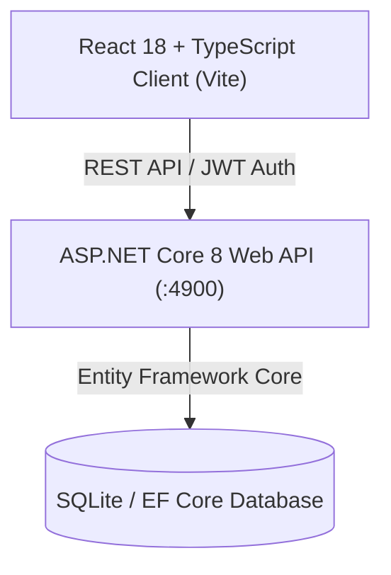

# AMAC Production & Operations Management System

An enterprise industrial management and shop-floor tracking portal designed for manufacturing execution, shift planning, multi-stage quality control, downstream traceability, and executive KPI analytics.

---

## System Architecture



### Tech Stack
* **Frontend:** React 18, TypeScript, Vite, Modern CSS Architecture
* **Backend:** ASP.NET Core 8 Minimal API, Entity Framework Core 8
* **Database:** SQLite (local development) / Microsoft SQL Server compatible
* **Authentication:** JWT (JSON Web Tokens) with Role-Based Access Control (Admin, Supervisor, Operator, HOD)

---

## Core Modules

### 1. Production Planning & Shift Entry
* **Daily Shift Planning:** Assign part numbers, machines, operators, and target quantities per shift.
* **Shop-floor Entry Form:** Real-time production recording with automated target achievement calculations, loss hours tracking, and downtime logging.
* **Supervisor Approval Workflow:** Dual-signoff verification for submitted shift batches.

### 2. Multi-Stage Quality & Traceability
* **Downstream Workflow:** Direct tracking across Die Casting & Fettling (DCF), Visual Inspection (VI1, VI2), Ultrasonic Testing (UT), and Final Quality.
* **Full Batch Traceability:** Instant lookup by batch ID linking parts to specific machines, operators, shifts, and timestamps.
* **Defect & Rejection Management:** Granular categorization of rework and scrap reasons per station.

### 3. Executive KPI & HOD Analytics
* **Operational Performance:** OEE (Overall Equipment Effectiveness), Total Produced, Planned vs. Actual GAP, and Rejection Rate tracking.
* **Interactive Breakdown Modal:** Progressive drill-down by Daily Trend, Machine Distribution, and Operator Performance.
* **Department Reports:** Tailored operational views for Production, DCF, and Quality HODs with Excel export capabilities.

### 4. Master Data & Administration
* **Master Database:** Part numbers, cycle times, weights, and production targets.
* **Staff Management:** Operator and supervisor roster management with shift assignment.
* **Reason Master:** Configurable gap and rejection reason taxonomy.

---

## Getting Started

### Prerequisites
* [.NET 8.0 SDK](https://dotnet.microsoft.com/download/dotnet/8.0)
* [Node.js](https://nodejs.org/) (v18.x or higher)
* [npm](https://www.npmjs.com/) (v9.x or higher)

---

### Backend Setup
```bash
cd backend
dotnet restore
dotnet run
```
The ASP.NET Core API server will initialize on `http://localhost:4900`.

---

### Frontend Setup
```bash
cd frontend
npm install
npm run dev
```
The Vite development server will start on `http://localhost:5175`.

---

### One-Click Launch (Windows)
To start both backend and frontend services simultaneously in development:
```powershell
.\start.bat
```

---

## Project Structure

```
├── backend/                  # ASP.NET Core Web API
│   ├── Migrations/           # Entity Framework Core migrations
│   ├── Models.cs             # Data models and DTO schemas
│   ├── Program.cs            # API routes, business logic & middleware
│   └── AmacBackend.csproj    # Project dependencies
│
├── frontend/                 # React + TypeScript frontend
│   ├── src/
│   │   ├── components/       # Production, Quality, HOD, and UI components
│   │   ├── context/          # Auth and Modal application state
│   │   ├── App.tsx           # Application routing and role protection
│   │   └── main.tsx          # Client entry point
│   └── vite.config.ts        # Vite configuration and API proxy
│
└── start.bat                 # Development launch script
```
